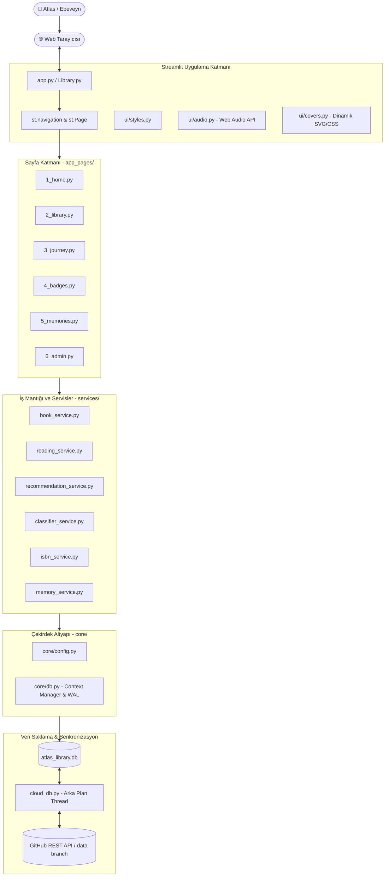
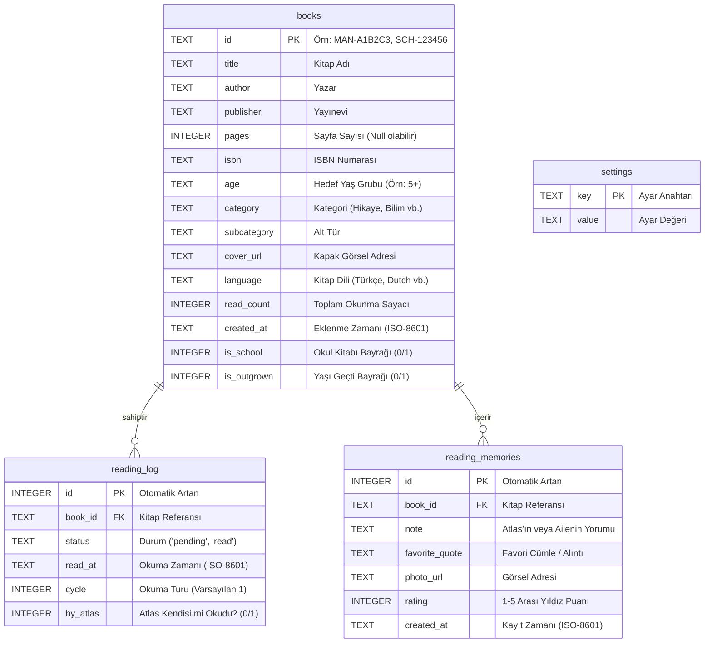
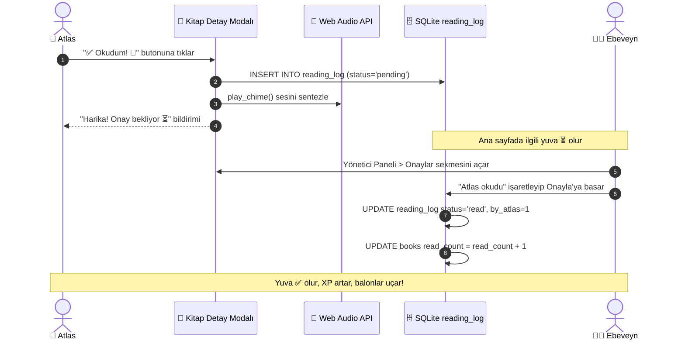

# 🏰 Atlas'ın Sihirli Kütüphanesi (Atlas Library)

[](https://www.python.org/downloads/)
[](https://streamlit.io/)
[](https://www.sqlite.org/)
[](#2-sistem-mimarisi-ve-teknik-tasarım)
[](#10-kalite-ve-bekçi-sistemleri)
[](ROADMAP.md)

**Atlas'ın Sihirli Kütüphanesi**, Atlas'ın okuma alışkanlığını desteklemek, fiziksel ev ve okul kitaplarını tek bir çatı altında dijitalleştirmek, çocuk psikolojisine uygun oyunlaştırma dinamikleri (XP, seviyeler, başarı rozetleri, sihirli çark) ve aile içi anılarla okuma serüvenini ölümsüzleştirmek üzere geliştirilmiş; **yüksek performanslı, modüler, reaktif ve tam test kapsamına sahip** bir kütüphane yönetim platformudur.

---

## 📑 İçindekiler

1. [🌟 Genel Bakış ve Temel Özellikler](#1-genel-bakış-ve-temel-özellikler)
2. [🏗️ Sistem Mimarisi ve Teknik Tasarım](#2-sistem-mimarisi-ve-teknik-tasarım)
3. [🗄️ Veritabanı Mimarisi, Şema ve İndeksleme](#3-veritabanı-mimarisi-şema-ve-indeksleme)
4. [☁️ Bulut Senkronizasyon Motoru (cloud_db.py)](#4-bulut-senkronizasyon-motoru-cloud_dbpy)
5. [🧠 Çekirdek Servisler ve Algoritmik Mantık](#5-çekirdek-servisler-ve-algoritmik-mantık)
   - [Kitap Yönetim Servisi (book_service)](#kitap-yönetim-servisi-book_service)
   - [Okuma ve Durum Takip Servisi (reading_service)](#okuma-ve-durum-takip-servisi-reading_service)
   - [Akıllı Öneri ve Çark Algoritması (recommendation_service)](#akıllı-öneri-ve-çark-algoritması-recommendation_service)
   - [Doğal Dil ve Kategori Sınıflandırıcı (classifier_service)](#doğal-dil-ve-kategori-sınıflandırıcı-classifier_service)
   - [Open Library ISBN Servisi (isbn_service)](#open-library-isbn-servisi-isbn_service)
   - [Anı Defteri Servisi (memory_service)](#anı-defteri-servisi-memory_service)
6. [🎨 Kullanıcı Arayüzü, Ses ve Görsel Motorlar (UI Katmanı)](#6-kullanıcı-arayüzü-ses-ve-görsel-motorlar-ui-katmanı)
   - [Bileşenler (ui/components.py)](#bileşenler-uicomponentspy)
   - [Dinamik Kapak Üreteci (ui/covers.py)](#dinamik-kapak-üreteci-uicoverspy)
   - [Web Audio API Ses Sentezleyici (ui/audio.py)](#web-audio-api-ses-sentezleyici-uiaudiopy)
   - [Stiller ve Tema (ui/styles.py)](#stiller-ve-tema-uistylespy)
7. [📱 Sayfalar ve Kullanıcı Arayüzü Mimarisi](#7-sayfalar-ve-kullanıcı-arayüzü-mimarisi)
   - [1. 🏠 Ana Sayfa](#1--ana-sayfa)
   - [2. 📖 Kütüphane Arşivi](#2--kütüphane-arşivi)
   - [3. 🏆 Okuma Yolculuğu](#3--okuma-yolculuğu)
   - [4. 🎖️ Başarı Rozetleri](#4-️-başarı-rozetleri)
   - [5. ✨ Anı Defteri (Reading Memories)](#5--anı-defteri-reading-memories)
   - [6. ⚙️ Yönetici Paneli](#6-️-yönetici-paneli)
8. [🔄 Uçtan Uca İş Akışları (Workflows)](#8-uçtan-uca-iş-akışları-workflows)
   - [Kurulum ve Çalıştırma](#kurulum-ve-çalıştırma)
   - [Günlük Okuma Akışı](#günlük-okuma-akışı)
   - [Ebeveyn Onay Mekanizması](#ebeveyn-onay-mekanizması)
   - [Akıllı Öneri Mantığı](#akıllı-öneri-mantığı)
   - [Veritabanı Yedekleme ve Senkronizasyon](#veritabanı-yedekleme-ve-senkronizasyon)
9. [🎮 Oyunlaştırma ve Hesaplama Matematiği](#9-oyunlaştırma-ve-hesaplama-matematiği)
10. [🛡️ Kalite ve Bekçi Sistemleri](#10-kalite-ve-bekçi-sistemleri)
    - [Kapsam Bekçisi (Scope Guard)](#kapsam-bekçisi-scope-guard)
    - [Doküman Bekçisi (Doc Guard)](#doküman-bekçisi-doc-guard)
11. [🔐 Güvenlik ve Secrets Yapılandırması](#11-güvenlik-ve-secrets-yapılandırması)
12. [🗺️ Sürüm Yol Haritası (ROADMAP.md)](#12-sürüm-yol-haritası-roadmapmd)

---

## 1. 🌟 Genel Bakış ve Temel Özellikler

- **Çift Taraflı Okuma Modeli:** Kitapların ebeveyn tarafından okunması ile Atlas'ın kendi başına okuduğu durumlar ayrı ayrı takip edilir (`by_atlas`). Her ikisi de XP ve seviyeye katkı sağlarken, bağımsız okuma için özel rozetler verilir.
- **Okul vs. Ev Kütüphanesi:** De Vuurvlinder okulundan ödünç alınan geçici kitaplar ev kütüphanesi envanterini kirletmeden kaydedilir; doğrudan Dutch okuma karnesine ve XP'ye işlenir.
- **Akıllı Akşam Kuralı (19:00+):** Uyku öncesi sakinliği sağlamak amacıyla saat 19:00'dan sonra Aktivite kitapları ve (opsiyonel) Dutch kitaplar öneri listelerinden dinamik olarak elenir.
- **Öncelikli Seri Kotası:** Okuma becerisini hızlandıran seriler (örn. Cin Ali) için günde en fazla tanımlanan kota kadar (varsayılan: 1) öneri sunulur; kalan öneriler diğer türlerden dengeli seçilir.
- **Anı Defteri (Reading Memories):** Okuma seanslarında yaşanan hatıralar, Atlas'ın değerlendirmeleri, unutulmaz replikler ve 1-5 yıldız arası değerlendirmeler kalıcı olarak saklanır.
- **Sıfır Harici Dosya Bağımlılığı ile Ses ve Görsel Üretimi:** Web Audio API ile tını sentezleme, SVG/CSS matematiksel algoritmalarıyla kapaksız kitaplara anında rengarenk pastel çocuk kitabı kapakları üretme.

---

## 2. 🏗️ Sistem Mimarisi ve Teknik Tasarım

Uygulama, monolitik kod tabanından arındırılmış, gevşek bağlı (loosely coupled) çok katmanlı bir mimariye sahiptir.



### Katmanlar ve Sorumluluklar:
1. **Giriş ve Yönlendirme:** `app.py`, sayfa yapılandırmasını (`st.set_page_config`), kimlik doğrulama kapısını ve `st.navigation` sayfa rotalarını yönetir. `Library.py`, geriye dönük uyumluluk köprüsüdür.
2. **Sayfa Sunumu (`app_pages/`):** Her sayfa izole bir script olarak çalışır, yalnızca ilgili arayüzü ve kullanıcı etkileşimini yönetir.
3. **Servis Katmanı (`services/`):** Arayüzden tamamen bağımsız, test edilebilir iş mantığı modülleridir.
4. **Çekirdek Katmanı (`core/`):** Merkezi sabitler (`core/config.py`) ve güvenli SQLite bağlantı yöneticisi (`core/db.py`).
5. **Kalıcı Saklama ve Senkronizasyon:** SQLite WAL motoru ve GitHub `data` branch eşitlemesi (`cloud_db.py`).

---

## 3. 🗄️ Veritabanı Mimarisi, Şema ve İndeksleme

Tüm kalıcı veriler yerel SQLite veritabanında saklanır. `core/db.py` modülü bağlantıları thread-safe bir context manager (`get_db()`) üzerinden yönetir, WAL (Write-Ahead Logging) modunu etkinleştirir ve olası hatalarda otomatik `ROLLBACK` işletir.



### B-Tree Performans İndeksleri
Sorguların yüzlerce kitap ve log arasında mikro saniyeler içinde tamamlanması için aşağıdaki indeksler otomatik olarak inşa edilir:
- `idx_reading_log_book_id`: Kitaba göre log aramalarında $O(\log N)$ erişim.
- `idx_reading_log_read_at`: Tarih aralığı, aylık/yıllık özetler ve streak hesaplamaları için.
- `idx_reading_log_status`: Onay bekleyen okumaları (`pending`) anında filtrelemek için.
- `idx_books_category`: Kategori dünyalarına göre kitap filtreleme için.
- `idx_books_language`: Türkçe / Dutch dil sorguları için.
- `idx_books_is_school`: Okul kitaplarını ev kütüphanesinden ayırmak için.
- `idx_books_is_outgrown`: Yaşı geçen kitapları öneri havuzundan tek adımda elemek için.
- `idx_memories_book_id`: Anı Defterinde kitaba ait notları anında getirmek için.

---

## 4. ☁️ Bulut Senkronizasyon Motoru (cloud_db.py)

Streamlit Community Cloud'un geçici (ephemeral) dosya sistemi nedeniyle, sunucu her uykuya daldığında diskteki veriler silinir. Bu sorunu çözmek için `cloud_db.py` modülü tasarlanmıştır:

1. **İteratif SQL Dökümü (`dump_db`):** SQLite'ın yerleşik `backup()` C-API'sini kullanarak canlı veritabanının bellekte anlık görüntüsünü alır (`:memory:`). Ardından `snap.iterdump()` ile deterministik bir SQL metin dökümü üretir.
2. **Debounce & Arka Plan Thread (`Sync`):** Daemon thread arka planda dosyayı saniyede bir izler (`POLL_SECONDS = 1.0`). Bir değişiklik tespit edildiğinde 1.5 saniye sakinleşme süresi (`QUIET_SECONDS = 1.5`) bekler.
3. **SHA-256 Değişiklik Tespiti:** SQL dökümünün SHA-256 özeti alınır. Özet son gönderilen ile aynıysa ağ isteği atılmaz.
4. **GitHub Contents API:** Değişiklikler deponun ayrı bir `data` branch'ine `db/atlas_library.sql` olarak commit edilir. (Cloud yalnızca `main` branch'ini izlediği için bu işlem uygulamayı yeniden başlatmaz).
5. **Çakışma ve Hata Yönetimi:** Ağ kopmalarında üstel geri çekilme (`5, 10, 20, 40, 60` saniye) uygulanır. Eğer GitHub'daki veri dışarıdan değişmişse (409/422 Conflict), yerel döküm `db/conflicts/{timestamp}.sql` yoluna kaydedilir ve veri ezilmesini önlemek için senkron güvenle durdurulur.
6. **Açılış Doğrulaması (`ensure_started`):** Uygulama açılırken GitHub'dan dökümü çeker, geçerli kayıt içerdiğini (`dump_has_records`) doğrular ve `os.replace` ile atomik olarak yerel dosyaya kurar.

---

## 5. 🧠 Çekirdek Servisler ve Algoritmik Mantık

### Kitap Yönetim Servisi (`book_service`)
- **Önbellek:** `get_books_df()`, `@st.cache_data(ttl=600)` ile belleğe alınır.
- **Geçersiz Kılma:** Kitap eklendiğinde, silindiğinde veya güncellendiğinde `clear_books_cache()` tetiklenir.
- **Kapak Doğrulama:** `get_clean_cover()` fonksiyonu `longitood.com` ve `deneyap-logo` gibi bozuk logo adreslerini filtreler.

### Okuma ve Durum Takip Servisi (`reading_service`)
- **Okuma Durum Makinesi:** 
  $$\text{Kayıt} \xrightarrow{\text{Çocuk}} \text{'pending'} \xrightarrow{\text{Ebeveyn}} \text{'read'} \ (\text{books.read\_count} \mathrel{+}= 1)$$
- **Mükerrerlik Koruması:** `record_pending_read()`, aynı kitabın aynı gün içinde birden fazla kez okunarak spam yapılmasını engeller.
- **Sayaç Eşitleme (`sync_read_counts`):** Olası bir veri tutarsızlığında `reading_log` onaylı kayıtlarını tarayarak `books.read_count` sütununu %100 doğrular.

### Akıllı Öneri ve Çark Algoritması (`recommendation_service`)
Öneri motoru iki aşamalı bir süzgeç işletir:

1. **Havuz Belirleme:**
   - Yaşı geçmiş kitaplar elenir (`is_outgrown == 0`).
   - Okul kitapları önerilmez (`is_school == 0`).
   - Seçili diller filtrelenir (`rec_languages()`).
   - Akşam saat 19:00 sonrasında `category != 'Aktivite'` ve (seçilmişse) `language != 'Dutch'` uygulanır.
2. **Öncelikli Seri Kotası:**
   Tanımlı öncelikli serilerden (örn. Cin Ali) günde en fazla $k$ kitap seçilir:
   $$k = \min(\text{priority\_quota\_left}(), \ n, \ |\text{pri\_unread}|)$$
   Kalan $n - k$ adet kitap diğer okunmamış ev kitaplarından dengeli olarak tamamlanır.
3. **Sihirli Çark (`spin_wheel`):** Günlük hedeften kalan miktar kadar ($n = \max(\text{goal} - \text{done}, 1)$) öneri üretir.

### Doğal Dil ve Kategori Sınıflandırıcı (`classifier_service`)
- **Hollandaca Dedektörü (`looks_dutch`):** Başlık kelimelerini regex ile tokenize eder ve `NL_WORDS` kümesiyle kesiştirir; yayınevini `NL_PUBLISHERS` listesinde arar.
- **Seri Tutarlılığı ile Otomatik Kategori Tarama (`auto_category_scan`):**
  - Başlıkta `:` öncesindeki seri öneklerini gruplar.
  - Aynı öneke sahip $\ge 4$ kitaptan oluşan bir seride $\%75$ çoğunluk kategorisi varsa, serinin diğer kitaplarına bu kategoriyi önerir.
  - Başlıkta `satranç`, `yoga`, `boyama` gibi belirteçler varsa `Aktivite`; `uzay`, `robot`, `fizik` varsa `Bilim`; `hayvan`, `orman`, `kuş` varsa `Doğa & Hayvanlar` kategorisini yüksek/orta güvenle önerir.

### Open Library ISBN Servisi (`isbn_service`)
- Open Library REST API'sine bağlanarak ISBN numarasından başlık, yazar, yayınevi, sayfa sayısı ve kapak görselini çeker.
- `requests` çağrıları `@st.cache_data(ttl=3600)` ile önbelleklenerek ağ trafiği optimize edilir.

### Anı Defteri Servisi (`memory_service`)
- `add_memory()`, `get_memories()`, `update_memory()`, `delete_memory()` ve `get_memory_stats()` metotlarıyla kitaplara ait özel anıları yönetir.

---

## 6. 🎨 Kullanıcı Arayüzü, Ses ve Görsel Motorlar (UI Katmanı)

### Bileşenler (`ui/components.py`)
- **`book_card()`:** Kitabın görselini, rozetlerini, sayfa sayısını, yaşını ve okunma sayısını sunar.
- **`show_book_detail()`:** Streamlit Dialog (`@st.dialog`) kullanarak modal pencerede detaylı künye, çocuk için "Okudum" butonu, anı ekleme formu ve ebeveyn için geçmiş tarihli kayıt girişini açar.
- **`render_hero()`:** Günlük görev yuvalarını (✅, ⏳), XP seviye çubuğunu ve streak ateşini çizer.

### Dinamik Kapak Üreteci (`ui/covers.py`)
Kapağı bulunmayan kitaplar için deterministik renk paletleri ve CSS gradyanları kullanılarak yüksek çözünürlüklü mockup kapaklar üretilir:
- Renk seçimi kitap başlığının MD5 özetinin palet boyutuna göre modülü alınarak yapılır:
  $$\text{Index} = \text{MD5}(\text{title}) \pmod 9$$
- Bu sayede aynı kitap her zaman aynı şık pastel renkle görüntülenir.

### Web Audio API Ses Sentezleyici (`ui/audio.py`)
Harici hiçbir ses dosyası indirmeden, tarayıcının yerleşik AudioContext arayüzü ile polifonik sinüs ve üçgen dalgaları sentezlenir:
- **Onay Tınısı (`play_chime`):** C5 (523Hz), E5 (659Hz), G5 (783Hz), C6 (1046Hz) notalarıyla neşeli bir yükselen arpej.
- **Kutlama Tınısı (`play_celebration`):** Görev tamamlandığında çalan zafer melodisi.

### Stiller ve Tema (`ui/styles.py`)
- `.streamlit/config.toml` ile uyumlu, çocuk dostu kart yuvarlaklıkları (`--r-card: 24px`), tatlı gölgeler (`--shadow`) ve responsive grid CSS kuralları tanımlanmıştır.

---

## 7. 📱 Sayfalar ve Kullanıcı Arayüzü Mimarisi

### 1. 🏠 Ana Sayfa
Atlas'ı karşılayan renkli hero kutusu, günlük okuma yuvaları, sihirli çark, rastgele öneri butonları, 7 temel kategori dünyası ve en son okunan 5 kitabın zaman tüneli.

### 2. 📖 Kütüphane Arşivi
Kitap adına ve yazara göre anlık arama, yayınevi ve kategori dropdown filtreleri, yaş uygunluğu seçimi ve 4 kolonlu kitap kartı kataloğu.

### 3. 🏆 Okuma Yolculuğu
7 galaktik durak (Ev ➔ Havalimanı ➔ Tren İstasyonu ➔ Şato ➔ Doğa ➔ Uzay ➔ Galaksi), ev/okul oranı, sayfa sayısı metrikleri, dillere göre okuma kartları ve kategori dağılım grafikleri.

### 4. 🎖️ Başarı Rozetleri
Toplam okunan kitap sayısına ve Atlas'ın bağımsız okuduğu kitap sayısına göre kilidi açılan altın, gümüş, bronz ve kahraman rozetleri.

### 5. ✨ Anı Defteri (Reading Memories)
Kitap okuma anıları, unutulmaz çocuk yorumları, favori alıntılar, yıldız değerlendirmeleri ve anı kartları akışı.

### 6. ⚙️ Yönetici Paneli
`ADMIN_PIN` ile korunan; Onaylar, Kitap Yönetimi, Kapak Yönetimi, Öneri & Düzen Ayarları ve Sistem Yedekleme işlemlerini barındıran 5 gruplu yönetim merkezi.

---

## 8. 🔄 Uçtan Uca İş Akışları (Workflows)

### Kurulum ve Çalıştırma
```bash
# 1. Depoyu klonlayın ve klasöre girin
git clone https://github.com/Blixembosch/atlas-library.git
cd atlas-library

# 2. Sanal ortamı hazırlayın
python3 -m venv .venv
source .venv/bin/activate

# 3. Bağımlılıkları yükleyin
pip install -r requirements.txt

# 4. Testleri çalıştırın
python3 run_tests.py

# 5. Uygulamayı başlatın
streamlit run app.py
```

### Günlük Okuma Akışı


### Ebeveyn Onay Mekanizması
- Bekleyen okumalar `reading_log` tablosundan çekilir.
- Ebeveyn tek tek veya "Hepsini Onayla" ile kayıtları onaylar.
- "Atlas okudu" kutucuğu işaretlenirse Atlas'ın bağımsız okuma sayacı artar.

### Akıllı Öneri Mantığı
- Yaşı geçen kitaplar elenir.
- 19:00 sonrasında Aktivite ve Dutch kitaplar önerilmez.
- Günlük Cin Ali kotası aşılmamışsa 1 adet Cin Ali, kalanı diğer kitaplardan seçilir.

### Veritabanı Yedekleme ve Senkronizasyon
- Canlı SQLite veritabanı tek tıkla indirilebilir.
- İndirilen yedek geri yüklendiğinde otomatik ön-yedekleme alınır ve `restore_db()` ile veri yerine koyulur.
- GitHub `data` branch eşitlemesi arka planda her değişikliği otomatik kaydeder.

---

## 9. 🎮 Oyunlaştırma ve Hesaplama Matematiği

- **Kazanılan XP:**
  $$\text{XP} = \text{total\_read\_books} \times 10$$
- **Mevcut Seviye (Level):**
  $$\text{Level} = \left\lfloor \frac{\text{XP}}{100} \right\rfloor + 1$$
- **Sonraki Seviyeye Kalan XP:**
  $$\text{InLevel} = \text{XP} \pmod{100}, \quad \text{ToNext} = 100 - \text{InLevel}$$
- **Kesintisiz Gün Serisi (Streak):**
  Bugün hedef tutturulduysa bugünden, tutturulmadıysa dünden geriye doğru gidilerek ardışık günlerin hedefleri kontrol edilir:
  $$\text{Streak} = \sum_{d=0}^{k} 1 \quad \text{şartıyla ki} \quad \text{done}(T - d) \ge \text{daily\_goal}$$

---

## 10. 🛡️ Kalite ve Bekçi Sistemleri

Projede sıfır hata toleransı için iki temel bekçi testi uygulanır:

### Kapsam Bekçisi (Scope Guard)
- **Kural:** *Her fonksiyon en az bir testte çalışmalı; yeni fonksiyon testsiz eklenince kırmızıya döner.*
- **Dosya:** `tests/test_kapsam_bekcisi.py`
- Projedeki tüm modülleri (`core/`, `services/`, `ui/`, `cloud_db.py`) AST ile denetler. Testsiz fonksiyon varsa build başarısız olur.

### Doküman Bekçisi (Doc Guard)
- **Kural:** *Bu README.md her sayfayı, çekirdek modülü, aracı, workflow'u ve Anı Defteri modülünü/sekmesini kapsamalıdır.*
- **Dosya:** `tests/test_dokuman_bekcisi.py`
- `README.md` içeriğini tarar; tüm sayfaların, çekirdek servislerin, iş akışlarının ve Anı Defteri'nin eksiksiz belgelendiğini doğrular.

```bash
# Test koşucusu
python3 run_tests.py
```

---

## 11. 🔐 Güvenlik ve Secrets Yapılandırması

Parolalar ve API anahtarları `.streamlit/secrets.toml` içinde tutulur:

```toml
ADMIN_PIN = "1234"
APP_PASSWORD = "atlas"

[github]
db_sync = true
token = "github_pat_..."
repo = "Blixembosch/atlas-library"
branch = "data"
base = "main"
```

---

## 12. 🗺️ Sürüm Yol Haritası (ROADMAP.md)

Geçmiş sürümlerin detaylı kronolojisi ve gelecek planları (v2.1 Okuma Zamanlayıcısı, Avatar Sistemi, Turso libSQL desteği) için [**ROADMAP.md**](ROADMAP.md) dosyasını inceleyebilirsiniz.

---

*Atlas için sevgiyle ve en yüksek mühendislik standartlarıyla geliştirilmiştir. Keyifli okumalar!* 🏰✨
